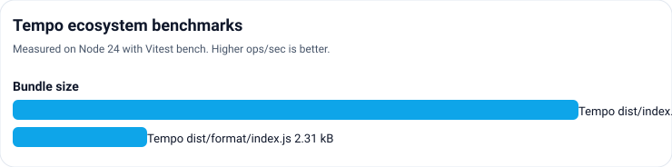
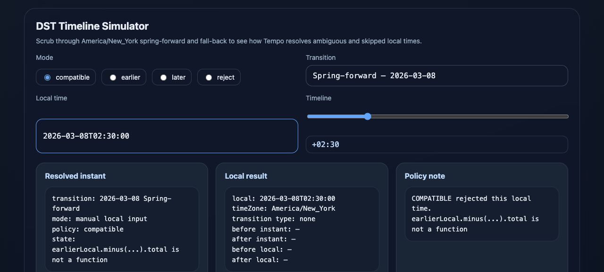
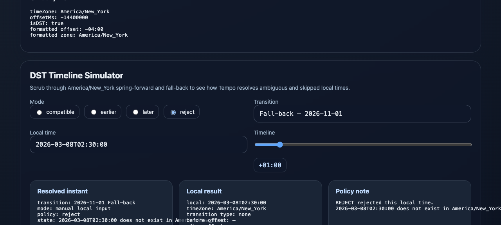

# Tempo

[](https://www.npmjs.com/package/@chloevpin/tempo)
[](https://www.npmjs.com/package/@chloevpin/tempo)
[](https://github.com/ChloeVPin/tempo)

Tempo is an immutable date and time library for JavaScript and TypeScript. Its core types follow Temporal concepts, parsing is strict by default, and optional entry points provide formatting, time zones, relative time, Temporal helpers, and Moment compatibility.



## Why Tempo?

Most JavaScript date bugs come from one mistake: treating time as a single number or a mutable bag of strings. Native `Date`, `@formkit/tempo`, Moment, and many later wrappers carry different versions of the same footguns. Tempo replaces those assumptions with separate, immutable value types, strict ISO parsing, predictable civil math, and an Intl-first timezone engine.

If you need a migration path from Moment, `@chloevpin/tempo/compat/moment` keeps the transition to idiomatic Tempo incremental. For a visual walkthrough of why native `Date`, `@formkit/tempo`, Moment, and core Tempo behave differently, see [docs/WHY-TEMPO.md](docs/WHY-TEMPO.md).

## Install

```sh
npm install @chloevpin/tempo
```

## Example

```ts
import { Instant, Interval, LocalDate } from '@chloevpin/tempo';

const date = LocalDate.parse('2026-06-01').plus({ days: 1 });
date.toISO(); // '2026-06-02'

const instant = Instant.parse('2026-06-01T16:00:00Z');
const week = Interval.of(instant, instant.plus({ days: 7 }));
week.contains(instant); // true
```

The package also exports `LocalTime`, `LocalDateTime`, `ZonedDateTime`, `Duration`, and optional subpaths such as `@chloevpin/tempo/format` and `@chloevpin/tempo/tz`. See [docs/API.md](docs/API.md) for the supported surface.

Invalid ISO values throw a `TempoError`; use the `tryParse` methods when a failed parse should be represented as data.

## Benchmarks

Tempo is built for real throughput. The 6-way ecosystem benchmark compares parse, arithmetic, and formatting across `Tempo`, `@js-temporal/polyfill`, `luxon`, `date-fns`, `dayjs`, and `moment` using Node 24 + Vitest bench.

| Case | Tempo | Temporal | Luxon | date-fns | dayjs | Moment |
| --- | ---: | ---: | ---: | ---: | ---: | ---: |
| Parse ISO date | 5,292,689 | 1,212,622 | 757,425 | 951,875 | 2,426,729 | 453,170 |
| Parse ISO instant | 2,250,680 | 1,087,579 | 755,506 | 5,624,498 | 3,573,773 | 257,548 |
| Parse local zoned | 212,424 | 597,332 | 110,613 | 5,639,947 | 3,523,080 | 255,391 |
| Plus day | 2,878,733 | 309,604 | 340,742 | 921,878 | 1,015,770 | 446,158 |
| Plus minute | 1,930,282 | 322,681 | 351,933 | 3,269,818 | 2,316,853 | 220,578 |
| Format ISO | 3,276,325 | 813,625 | 717,195 | 2,534,973 | 592,295 | 421,279 |
| Format with time tokens | 2,207,541 | 157,873 | 394,736 | 614,342 | 560,782 | 208,009 |

Run `npm run bench:artifacts` to regenerate `assets/benchmarks.svg` and [docs/BENCHMARKS.md](docs/BENCHMARKS.md).

## Bundle size

| Package | gzip |
| --- | ---: |
| `dist/index.js` | 9.73 kB |
| `dist/format/index.js` | 2.31 kB |

Run `npm run size` to verify the package-size gates on your machine.

## Comparison

| | Native Date | @formkit/tempo | Moment | Tempo core |
| --- | --- | --- | --- | --- |
| Separate types | no | no | no | yes |
| Immutable API | no | yes | no | yes |
| Strict ISO default | no | no | no | yes |
| Month-end safety | no | yes | no | yes |
| DST policy control | no | no | no | yes |
| Zero runtime deps | n/a | yes | no | yes |

## Playground

[Try the interactive Web Playground](http://127.0.0.1:3100) to inspect live ISO parsing, format tokens, and DST disambiguation behavior.




## Terminal showcase

```sh
node bin/showcase.mjs
```

The terminal showcase walks through type separation, zero-dependency civil math, timezone conversion, and an ASCII DST diagram in your local terminal.

## Migrate from Moment

Tempo is a clean break. The core API is Temporal-shaped, immutable, and strict. If you need a stepping stone, use `@chloevpin/tempo/compat/moment` for the common 20 methods, then delete it.

1. Inventory `moment` / `moment-timezone` imports and mutable usage.
2. Swap leaf files to `@chloevpin/tempo/compat/moment`.
3. Replace `format` / `add` / `diff` / `toISOString` with core types.
4. Replace `moment.tz` with `ZonedDateTime`.
5. Delete the adapter.

See [docs/MIGRATION.md](docs/MIGRATION.md) for the full migration guide and [docs/WHY-TEMPO.md](docs/WHY-TEMPO.md) for the breakage guide.

## Develop and test

```sh
npm install
npm run build
npm test
npm run typecheck
npm run lint
```

Additional size, benchmark, and mutation commands are listed in [package.json](package.json). Compatibility behavior and migration guidance are documented in [docs/MIGRATION.md](docs/MIGRATION.md). For a visual walkthrough of native `Date`, `@formkit/tempo`, Moment, and core Tempo failure modes, see [docs/WHY-TEMPO.md](docs/WHY-TEMPO.md).

## License

Tempo is available under the [MIT license](LICENSE).
